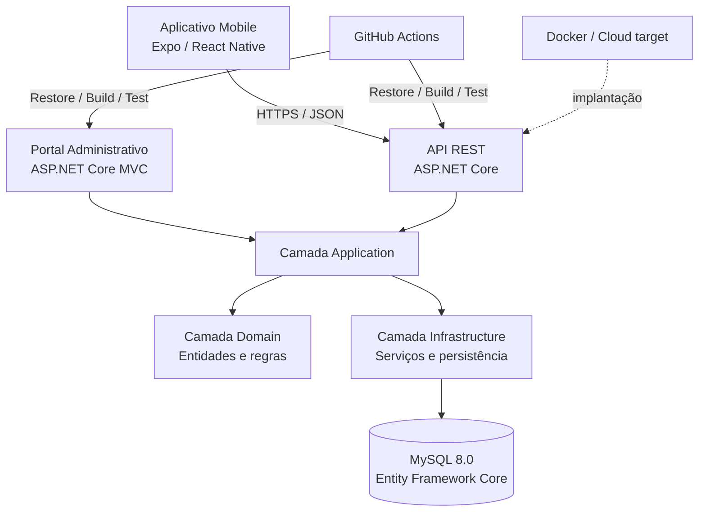
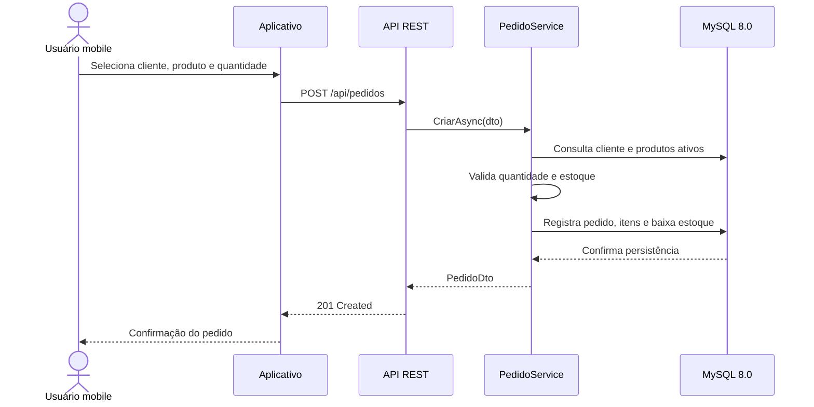

# Arquitetura da solução

## Visão lógica

## Responsabilidades

- **Domain:** entidades `Produto`, `Cliente`, `Pedido`, `ItemPedido` e enumeração `StatusPedido`.
- **Application:** DTOs e interfaces `IProdutoService`, `IClienteService`, `IPedidoService` que definem os contratos da aplicação.
- **Infrastructure:** `AppDbContext`, mapeamento relacional, serviços concretos e integração MySQL via EF Core (Pomelo).
- **Web:** interface administrativa MVC; os controllers recebem serviços por injeção de dependência.
- **API:** recursos REST consumidos pelo mobile e por possíveis sistemas externos.
- **Mobile:** cliente de API; não acessa o banco diretamente.

## Fluxo de criação de pedido

## Decisões técnicas

1. API e Web compartilham contratos de aplicação e infraestrutura, evitando duplicação de regras de negócio.
2. O mobile consome exclusivamente a API REST.
3. Exclusão lógica (`Ativo = false`) preserva histórico de produtos e clientes.
4. O pedido armazena preço unitário praticado no momento da venda, mantendo histórico mesmo após reajustes no catálogo.
5. Relacionamentos usam chaves estrangeiras; preços usam `DECIMAL(18,2)`.
6. A baixa de estoque ocorre no serviço de pedidos, após validação de disponibilidade. Para produção, deve ser protegida por transação/concorrência otimista para evitar vendas simultâneas acima do estoque.
