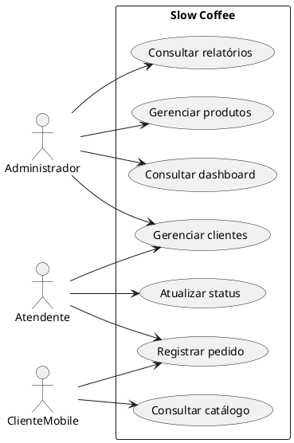

# Diagramas UML — visão inicial

## Casos de uso (PlantUML)



## Diagrama de classes simplificado (PlantUML)

```plantuml
@startuml
class Cliente { +int Id +string Nome +string Telefone +string Email +bool Ativo }
class Produto { +int Id +string Nome +string Categoria +decimal Preco +int Estoque +bool Ativo }
class Pedido { +int Id +int ClienteId +DateTime CriadoEm +StatusPedido Status +decimal ValorTotal }
class ItemPedido { +int Id +int PedidoId +int ProdutoId +int Quantidade +decimal PrecoUnitario +decimal Subtotal }
enum StatusPedido { Recebido EmPreparo Pronto Entregue Cancelado }
Cliente "1" -- "0..*" Pedido
Pedido "1" *-- "1..*" ItemPedido
Produto "1" -- "0..*" ItemPedido
Pedido --> StatusPedido
@enduml
```

Os diagramas representam o modelo implementado no repositório; podem ser renderizados com PlantUML ou convertidos para imagens para inclusão no documento acadêmico.
