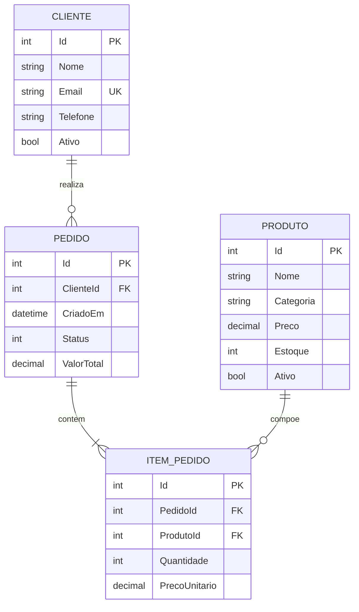

# Modelo de dados

## Entidades e atributos

- **Cliente:** Id (PK), Nome, Telefone, Email (único), Ativo, CriadoEm.
- **Produto:** Id (PK), Nome, Categoria, Preco, Estoque, Ativo, CriadoEm.
- **Pedido:** Id (PK), ClienteId (FK), CriadoEm, Status, ValorTotal.
- **ItemPedido:** Id (PK), PedidoId (FK), ProdutoId (FK), Quantidade, PrecoUnitario.

## Relacionamentos

- Cliente 1:N Pedido.
- Pedido 1:N ItemPedido.
- Produto 1:N ItemPedido.

## DER (Mermaid)

## Normalização e integridade

As entidades principais possuem tabelas próprias; os itens de pedido ficam em tabela associativa, evitando repetição de múltiplos produtos em colunas fixas do pedido. Chaves primárias identificam registros e chaves estrangeiras mantêm integridade referencial. Valores monetários são armazenados em `DECIMAL(18,2)`. Índices apoiam pesquisas por status, data de pedido, categoria e relacionamento dos itens.
